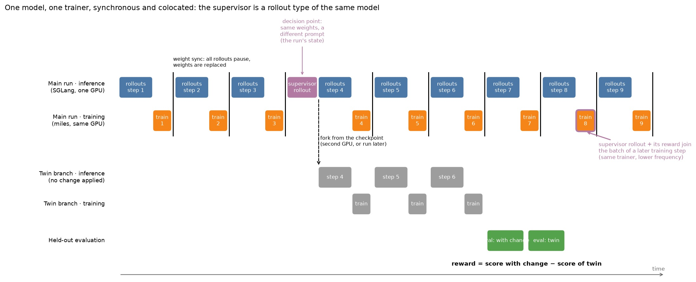

::: {.callout-note}
This is a draft. It can change.
:::

## The job

Anyone who has trained a model with reinforcement learning (RL) knows the routine. You start a run. You watch
the reward curve. It goes up, then it goes flat, then it does something strange at 2 a.m. You open the logs, find
that the grader has been marking correct answers as wrong since step 12, fix it, and start again.

We want a model that does this job. It watches a live RL post-training run, forecasts where the run is going,
finds what is wrong, and changes it. The test is simple: does a run with this model end better than the same run
without it?

The model is Inkling 2 Mini. The runs it watches are RL post-training runs of Inkling 2 Mini, on
[miles](https://github.com/radixark/miles), on one GPU. So it babysits runs of itself, and what it learns goes
back into the same weights. The published systems we read keep the two apart: in
[AutoRL](https://arxiv.org/abs/2611.17790) the watching agents are frozen models.

Before any of that can happen, the model needs practice material. This post is about finding it.

## Four verbs

Every task we found asks the model to do something to a training run. We sort them by when in the life of a
run the work happens.

| Verb | The question | What the model hands in |
|---|---|---|
| **Predict** | How will this run turn out? | a forecast: a curve, a final number, or which of two runs wins |
| **Build** | Can you write the piece that makes training better? | code: a loss, an estimator, a library feature |
| **Run** | Can you take a model and a target, and make the model better? | a trained checkpoint |
| **Read** | This run happened. What went wrong, and how do you fix it? | a diagnosis, or a repair |

A person who is good at this job does all four. They guess the outcome before spending compute (Predict), write
the fix (Build), launch the job (Run), and work out why last night's run died (Read).

## What an answer costs to check

The four verbs differ in price. The price follows one rule: how much of a real training run do we have to
execute to know whether the answer was right?

| Verb | How an answer is checked | Cost to check one answer |
|---|---|---|
| Predict | compare the forecast with what the run did | cents; one model call |
| Read | compare the diagnosis with the known cause | about $0.05 |
| Build | run the code against hidden tests or data | $0.10 to $1.50 |
| Run | train, then evaluate on held-out data | about $0.60 for the smallest cycle; hundreds of dollars for a large one |

So the plan writes itself: practice on the cheap verbs, and save the expensive ones for the exam.

## Where the GPU sits

"Needs a GPU" hides three different situations. It matters, because a GPU that sits next to a thinking model
is paid for every second the model thinks.

| Verb | Dataset | The model's box | The grader's box |
|---|---|---|---|
| Predict | Tea Leaves | no GPU | no GPU |
| Read | AutoRLBench diagnosis, RFT-FaultBench | no GPU | no GPU |
| Read | AutoRLBench repair | no GPU: the model only edits files | GPU: reruns the training to check the fix |
| Build | DiscoGen, some AutoResearchExam tasks | GPU: the model runs training to try its code | GPU: retrains on hidden data |
| Run | RSI-Dojo | GPU: the model trains the checkpoint | GPU: serves the checkpoint and scores it |

The repair tasks are the pleasant surprise: the model needs no GPU at all, and the grader holds one only for the
rerun. The Build tasks are the costly ones, because the GPU waits while the model decides what to try next. We
measured it: in a DiscoGen attempt, 82 to 96% of the time is spent inside a training command, so four attempts
sharing one GPU have to queue.

## The data we kept

### Predict

| Dataset | What one task is | Size | Source |
|---|---|---|---|
| Tea Leaves | see the first 20% of a training curve, with its settings, description and code; forecast the rest | 918 logged runs to learn from; 682 test runs, 150 of them RL | [paper](https://arxiv.org/abs/2611.30141), [data](https://huggingface.co/datasets/xinranz3/read-tea-leaves) |

The paper behind it has a line we keep coming back to. Knowing a part of training has three levels: describing
it, implementing it, and anticipating what it does to a run. Models are usually asked for the first two. The job
needs the third.

### Build

| Dataset | What one task is | Tasks | Source |
|---|---|---|---|
| HF_ML_Tasksmith | implement a merged pull request in trl, peft, accelerate, diffusers or transformers; hidden tests grade it | 15 | [data](https://huggingface.co/datasets/FineEnvs/HF_ML_Tasksmith) |
| AutoResearchExam | improve a research result (an estimator, an encoder, an RL trainer); submit, see a validation score, improve | 18 on CPU, 3 on a small GPU | [repo](https://github.com/bespokelabsai/AutoResearchExam) |
| DiscoGen | rewrite the loss, optimizer or network of PPO, DQN or an image classifier; scored on datasets the model never saw | 20 | [paper](https://arxiv.org/abs/2603.17863), [repo](https://github.com/AlexGoldie/discogen) |

### Run

| Dataset | What one task is | Tasks | Source |
|---|---|---|---|
| RSI-Dojo | post-train a model to raise its score on a target benchmark | 85 cheap targets of 281 | [paper](https://arxiv.org/abs/2611.03698), [data](https://huggingface.co/datasets/szgao/RSI-Dojo) |
| DAPO-Math-17K | the inner run itself: RL on 17,390 math problems; the same data AutoRL trains its Qwen runs on | 1 run recipe | [AutoRL paper](https://arxiv.org/abs/2611.17790) |

### Read

| Dataset | What one task is | Tasks | Source |
|---|---|---|---|
| AutoRLBench, diagnosis | read the logs, config and code of a real failed RL run; name the cause, with evidence | 50 | [repo](https://github.com/Thinking-Space/AutoRLBench) |
| AutoRLBench, repair | edit the failed run once; a rerun of the training decides whether the fix worked | 3 on CPU, 5 with a GPU rerun | same |
| RFT-FaultBench | read the telemetry of an RL fine-tuning run; say if it is healthy, and if not, which fault it has | 146 of 2,630 runs | [paper](https://arxiv.org/abs/2605.04431), [data](https://doi.org/10.5281/zenodo.23612747) |

### The exams

These are never trained on. Most of them carry a line that asks for exactly that.

| Verb | Benchmark | Source |
|---|---|---|
| Build, Run | RSI Bench (Scale), 49 tasks | [repo](https://github.com/scaleapi/rsi-benchmark) |
| Run | PostTrainBench | [repo](https://github.com/aisa-group/PostTrainBench) |
| Run | FrontierRSI | [repo](https://github.com/abundant-ai/frontier-rsi) |
| Run | an RL post-training task on Olmo-3-7B | [Harbor Hub](https://hub.harborframework.com/datasets/ale/rsi-post-training) |
| Read | AgenticRL-Bench | [repo](https://github.com/eigent-ai/agenticrl-bench), [Kaggle](https://www.kaggle.com/benchmarks/eigent/agenticrl-bench/leaderboard) |

## Three tasks up close

**Read, from RFT-FaultBench.** The model gets the per-step logs of an RL run: reward, KL, entropy, response
length, and sampled answers. Some runs are healthy. Others had a fault injected, such as a reward that collapses
or an advantage with the wrong sign. The model writes a short answer in this shape (the values are only an
example):

```json
{"status": "anomalous", "fault_family": "credit_assignment", "fault_type": "advantage_instability",
 "evidence": "what in the logs shows it"}
```

A program grades it: 0 for the wrong status, more for the right family, full marks for the right type.

**Build, from DiscoGen.** The model gets a working PPO trainer. Only `loss.py` is editable. It can run training
on two games to see how its loss does. When it stops, the grader trains with its loss on two other games it never
saw, and compares with the standard loss.

**Run, from RSI-Dojo.** The model gets a base model and a target benchmark. It trains, then the grader evaluates
the checkpoint on 300 held-out rows. In our timing test, one 15-minute fine-tune plus the evaluation took about
17 minutes on one small GPU and cost about $0.57.

## How Inkling 2 Mini did on a first try

We ran the untrained model on a few tasks from each set, mostly to find out whether the tasks work.

- **It thinks every run is sick.** On RFT-FaultBench it called all four healthy runs anomalous. Its mean score was
  0.42. A few lines of statistics with no model at all score 0.53.
- **It repaired one failed run in twelve tries.** Fixing a run is much harder than describing what is wrong
  with it.
- **Its new loss functions mostly made training worse.** On DiscoGen, most attempts landed below the unmodified
  baseline.
- **It solved 14 of 36 library tasks on every attempt.** Those tasks teach nothing, so they are out.

That is the right shape for practice material: some things too easy, some too hard, most in between.

## Things that went wrong, so you can skip them

1. **Read the tasks, not the dataset card.** We read 176 sets and kept 7. Cards did not mention that one set
   ships the solution in the starting files, another keeps the answer key next to the data, and a third wants 8
   hours per try.
2. **A task named after its own bug is not a diagnosis task.** One benchmark's task folders had names like
   `verl_grpo_adamw_eps_too_large`. We renamed all of them to numbers.
3. **If the model can fool the grader, it will be rewarded for it.** A speed task timed the same input ten
   times, so a solver that remembered its answer got full marks. A research task let the edited file print its
   own score. Every grader now runs in a separate box, and the model's box has no internet.
4. **Check that a "verified" label means what you think.** In one dataset the flag meant the final score fell,
   not that the fault shows in the logs.
5. **Partial scores beat pass or fail.** A small model rarely solves a hard task fully. The share of tests passed,
   or the gain over a baseline, still tells it which attempt was better.
6. **Look at the time of one experiment, not the published budget.** A task with a 24-hour budget works in one
   hour if one try takes two minutes.
7. **These tasks are hard for the best models too.** On AgenticRL-Bench the top model solves 22.8% of attempts.
8. **Judge a dataset per use.** A set that fails as practice can still be a good exam. We got this wrong more
   than once and had to go back.

## How the experiment will work

One inner run uses one dataset, as in AutoRL. The model, acting as supervisor, looks at the run at fixed points
and may change three things: the **data** (which tasks, in what order, with what reward), the **harness** (prompt,
tools, turn limit, effort) and the **model** side (learning rate, loss, adapter size). It has a small budget of
changes per run, so it has to choose.

Did a change help? We copy the run at that point into two branches: one with the change and one without. Both
run a short window and are scored on held-out data. The reward is the difference. We also check a sample of the
moments where the supervisor chose to do nothing, to see what a change would have done.

The supervisor is not a special model. Its decisions are rollouts like any other. They go to the same trainer
and update the same weights, only less often.



Three arms tell us what happened:

| Arm | Setup | What it shows |
|---|---|---|
| A | fixed recipe, no supervisor | the baseline |
| B | the supervisor acts, but is not trained on its decisions | whether its changes help |
| C | the supervisor acts, and is trained on its decisions | whether learning to supervise helps |

## Every dataset we read

| Why | Sets |
|---|---|
| **Kept** | Tea Leaves, HF_ML_Tasksmith, AutoResearchExam, DiscoGen, RSI-Dojo, AutoRLBench, RFT-FaultBench |
| **Exam only: the owners ask that it is not used for training** | RSI Bench (Scale), AgenticRL-Bench, AutoLab, Accelerate Bench, HPCAgent-Bench, MLGym-Bench, cpu2gpu, leakbench, Auditing Sabotage Bench, FrontierCS 2, Terminal-Bench |
| **Exam only: too long or too costly to practise on** | PostTrainBench, FrontierRSI, DeepRSI, the Olmo and Qwen RL post-training tasks |
| **Outside our domain** | SLDBench v2, AlgoTune, OpenMLE-Tasks |
| **The score can be forged, or the answers leak** | MLS-Bench, MLOps-Bench, MetaKernelBench, mlagentgym |
| **The tasks do not work as tasks** | WeightBench, KernelGenBench, FACET, LegoFlow, Logics, MiMo |
| **Too long per attempt** | frontier-ml, AI4AI-Bench, ProgramGym, TerminalHorizon, SWE-fficiency |
| **Too heavy to obtain or build** | SandMLE, SciCoQA, AIFaultBench |
| **Duplicates or low priority** | DARE-bench, PerfArena, Finch Collection |
| **Not RL** | RSIGym |
| **General software and terminal tasks, outside our scope** | SWE-rebench, R2E-Gym, SETA, TMax, smol-software-harbor and about 15 others |
